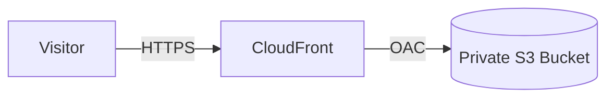

# Luis Antonio Burgos

### Aspiring Cloud Engineer | AWS · Terraform · Automation

Building secure, repeatable cloud infrastructure through hands-on projects.

[Live Portfolio](https://d3e94t96gv66gp.cloudfront.net/) · [Featured Project](https://github.com/luisantonioburgos9751/personal-cloud-portfolio)

---

## About Me

I'm an aspiring Cloud Engineer focused on developing practical skills in AWS, Infrastructure as Code, cloud security, and automation.

I learn by building real cloud projects, testing their behavior, troubleshooting problems, and documenting technical decisions.

My goal is to grow into a Cloud Engineering role while continuing to strengthen my foundations in infrastructure, networking, security, and DevOps practices.

---

## Technical Skills

**Cloud Infrastructure**
- AWS S3, CloudFront, IAM
- Cloud security and access control
- Static website hosting with HTTPS

**Infrastructure as Code**
- Terraform
- Resource imports and state management
- Remote state with Amazon S3

**Automation & DevOps**
- Git and GitHub
- GitHub Actions
- PowerShell and AWS CLI
- Continuous Integration
- Repeatable deployment scripts

**Web Technologies**
- HTML5
- CSS3

---

## Featured Project

### Personal Cloud Portfolio

A secure, cloud-hosted portfolio built using AWS and Terraform.

**The challenge:** Publish and maintain a technical portfolio securely, with controlled costs and repeatable updates, without managing servers.

**Architecture**

**What I implemented:**

- Private S3 hosting with public access blocked.
- HTTPS delivery through Amazon CloudFront.
- Origin Access Control to restrict direct S3 access.
- Terraform configuration for existing AWS infrastructure.
- Remote Terraform state stored in S3.
- GitHub Actions for automated HTML and CSS validation.
- PowerShell deployment script using AWS CLI.
- CloudFront cache invalidation after deployment.

**Verified results:**

- Direct anonymous S3 access denied.
- Website accessible through CloudFront.
- Terraform plan completed without infrastructure changes.
- CI validation completed successfully.
- CloudFront invalidation reached `Completed`.
- Website and stylesheet returned HTTP `200 OK`.

**Explore the project:**

[Live Website](https://d3e94t96gv66gp.cloudfront.net/) · [Source Code](https://github.com/luisantonioburgos9751/personal-cloud-portfolio) · [Deployment Guide](https://github.com/luisantonioburgos9751/personal-cloud-portfolio/blob/main/docs/deployment.md) · [Security Validation](https://github.com/luisantonioburgos9751/personal-cloud-portfolio/blob/main/docs/seg-01.md)

---

## Currently Learning

I'm currently expanding my knowledge in:

- AWS cloud architecture and services
- Terraform and Infrastructure as Code
- Cloud networking and security
- Deployment automation and CI/CD practices

My focus is on understanding not only how to deploy infrastructure, but also how to secure, validate, maintain, and document it.

---

## Professional Goals

I'm building a technical portfolio to pursue opportunities in:

- Junior Cloud Engineering
- Cloud Support
- IT Infrastructure
- Cloud and DevOps-related entry-level roles

I value practical learning, clear documentation, and continuous technical improvement.

---

### Explore My Work

[GitHub Projects](https://github.com/luisantonioburgos9751?tab=repositories) · [Personal Portfolio](https://d3e94t96gv66gp.cloudfront.net/)

